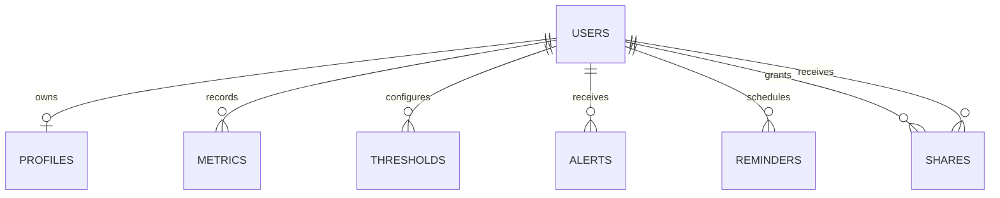

# Mô hình dữ liệu

- `users`: tài khoản và vai trò admin/user/viewer.
- `profiles`: hồ sơ 1-1 với user.
- `metrics`: số đo theo thời gian; huyết áp dùng `value` = tâm thu và `secondary_value` = tâm trương.
- `thresholds`: ngưỡng theo user + loại chỉ số, lưu tên nguồn, URL và bối cảnh.
- `alerts`: lịch sử cảnh báo theo số đo.
- `reminders`: lịch nhắc đo, thuốc, vận động.
- `shares`: quan hệ chủ dữ liệu → viewer, có thời điểm đồng ý và thu hồi.

Mọi truy vấn riêng tư phải ràng buộc user id lấy từ JWT. Viewer chỉ đọc dữ liệu khi có share đang hoạt động; admin không tự động được đọc dữ liệu sức khỏe.